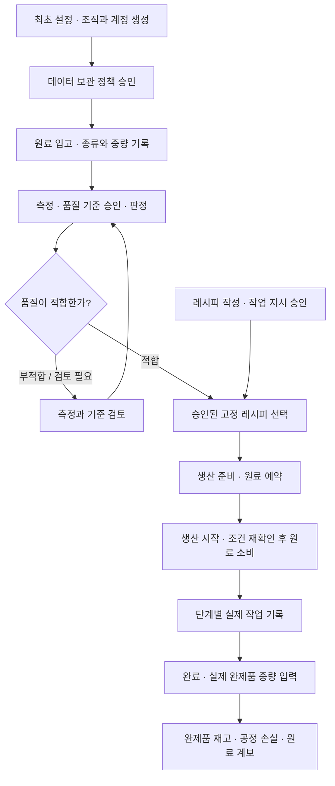
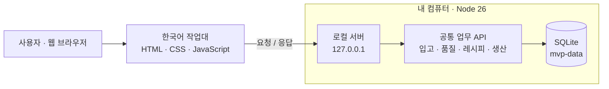

# FOODB MVP

**원료가 들어온 순간부터 완제품이 나올 때까지, 품질·작업 기록·재고를 연결하는 로컬 생산 관리 앱입니다.**

식품 생산 담당자가 “이 원료를 사용해도 되는가?”, “얼마나 예약했고 얼마나 남았는가?”, “이 완제품은 어떤 원료로 만들었는가?”를 같은 작업공간에서 확인하도록 만들었습니다. 현재 MVP는 사람이 측정하고 승인하는 **단일 원료·고정 레시피 생산**에 집중합니다.

| 한눈에 보기 | 현재 MVP |
| --- | --- |
| 사용 방식 | 내 컴퓨터에서 서버를 실행하고 브라우저로 접속 |
| 기본 화면 | 한국어 작업대: 입고, 품질, 레시피, 생산, 재고 |
| 실행 환경 | Node 26.x + 내장 SQLite, 추가 패키지 설치 불필요 |
| 데이터 저장 | 실행한 컴퓨터의 `mvp-data` 폴더 |
| 개발 상태 | 핵심 흐름 구현, 자동 테스트 32개 통과, 실제 브라우저 인수 검사 대기 |

[바로 실행](#바로-실행) · [사용 흐름](#사용-흐름) · [구현 범위](#구현-범위) · [남은 작업](#검증-상태와-남은-작업)

## 어떤 일을 도와주나요?

종이에 적거나 따로 관리하던 원료 입고, 측정 결과, 작업 지시, 생산 실적을 하나의 이력으로 연결합니다.

| 현장에서 생기는 질문 | FOODB에서 확인하는 내용 |
| --- | --- |
| 어떤 원료가 얼마나 들어왔나? | 입고 묶음별 원료 종류와 중량 |
| 이 원료를 생산에 써도 되나? | 측정값, 승인된 품질 기준, 최신 판정, 안전 보류 |
| 다른 생산에 이미 배정된 양은? | 보유량·예약량·가용량 |
| 어떤 순서로 작업해야 하나? | 승인된 레시피의 단계별 작업 지시 |
| 실제로 어떻게 만들었나? | 단계별 실제 기록, 지시와의 차이, 완제품 중량 |
| 이 완제품의 원료는 무엇인가? | 원료부터 완제품까지 연결된 계보 |

**용어는 두 가지만 알아두면 됩니다.** `로트(lot)`는 함께 입고되거나 생산되어 하나로 추적하는 재고 묶음이고, `배치(batch)`는 한 번의 생산 작업 단위입니다.

## 사용 흐름

아래는 실제 화면 캡처가 아닌, 구현된 업무 흐름을 설명하는 도식입니다. GitHub에서는 Mermaid 다이어그램으로 표시됩니다.



### 예시: 원료 10kg 중 4kg으로 생산하기

다음은 재고 변화를 이해하기 위한 가상의 예시입니다. 식품 품질 기준이나 실제 제조법을 제시하는 예시는 아닙니다.

| 시점 | 수행하는 일 | 기록되는 결과 |
| --- | --- | --- |
| 입고 | 원료 A를 10kg 입고 | 원료 보유 10kg, 가용 10kg |
| 품질 확인 | 측정값을 입력하고 승인된 기준으로 판정 | 해당 원료 로트의 품질 판정 저장 |
| 생산 준비 | 원료 A 4kg을 쓰는 승인 레시피 선택 | 보유 10kg 중 4kg 예약, 가용 6kg |
| 생산 시작 | 현재 품질·보류·재고 상태를 재확인 | 원료 4kg 소비, 원료 잔량 6kg |
| 생산 완료 | 작업 기록 후 완제품 3.5kg 입력 | 완제품 3.5kg과 공정 손실 0.5kg 기록 |
| 이력 확인 | 완제품의 계보 조회 | 사용한 원료 로트와 생산 기록 확인 |

생산 준비 중에는 원료를 **예약**하고, 실제 시작할 때 **소비**합니다. 시작 전에는 취소해서 예약을 반환할 수 있습니다. 시작 후에는 취소 버튼으로 이미 소비한 원료를 되돌리지 않습니다.

작업 지시와 다른 내용이 발생하면 생산을 보류하고 담당자의 검토를 거칩니다. 안전 보류, 만료된 품질 증거, 변경된 판정 등은 생산 진행을 차단할 수 있습니다.

## 바로 실행

**준비물: Node 26.x와 웹 브라우저.** 검증에 사용한 Node 버전은 `26.5.0`입니다. MVP에는 `npm install`, Bun 설치, 별도 화면 빌드가 필요하지 않습니다.

저장소가 없다면 먼저 내려받습니다.

```sh
git clone https://github.com/Deviskido/FOODB.git
cd FOODB
```

이미 내려받았다면 `FOODB` 폴더에서 다음을 실행합니다.

```sh
npm run doctor
npm run start:mvp
```

브라우저에서 **http://127.0.0.1:3000**을 엽니다. 종료할 때는 터미널에서 `Ctrl+C`를 누릅니다. Windows에서는 Node 26 설치 후 `start-mvp.cmd`로 실행할 수도 있습니다. Windows 실기 검증은 아직 남아 있습니다.

첫 사용 순서:

1. 조직과 소유자 계정을 만듭니다. 기본 계정은 없으며 비밀번호는 최소 12자입니다.
2. 로그인하고 데이터 보관 목적과 기간을 승인합니다.
3. 원료를 입고하고 측정값·품질 기준·판정을 입력합니다.
4. 단일 원료 레시피와 작업 지시를 작성해 승인합니다.
5. 생산 준비 → 시작 → 단계별 기록 → 완료를 진행합니다.

최초 계정은 모든 운영 역할을 가집니다. 여러 사람이 사용할 때는 역할별 계정을 추가할 수 있습니다. 상세 입력 순서는 [MVP 사용 안내](docs/MVP.md)를 참고하세요.

### 운영 데이터와 분리해서 연습하기

```sh
npm run demo:mvp
```

| 모드 | 접속 주소 | 기본 데이터 폴더 |
| --- | --- | --- |
| 운영 | http://127.0.0.1:3000 | `mvp-data` |
| 시뮬레이션 | http://127.0.0.1:3001 | `mvp-demo-data` |

시뮬레이션은 화면에 모드를 표시하는 **빈 작업공간**입니다. 예제 데이터가 자동으로 채워지지는 않으며 시험 계정·원료·기준을 직접 입력합니다.

`APP_DATA_DIR`, `PORT`, `APP_MODE`로 저장 경로·포트·모드를 설정할 수 있습니다. 하나의 데이터 폴더를 두 프로세스에서 동시에 열면 안 됩니다.

## 구현 범위

| 영역 | 현재 사용할 수 있는 기능 |
| --- | --- |
| 계정·권한 | 조직·사용자 생성, 로그인·로그아웃, 역할별 작업 제한 |
| 입고·재고 | kg 입고, 정수 mg 저장, 보유·예약·가용량 조회 |
| 품질 | °Bx(당도 지표)·pH 수동 측정, 불확실성·유효시간, 기준 작성·승인, 품질 판정 |
| 레시피 | 단일 원료 고정 레시피, 단계별 지시, 알레르기·예상 수율, 승인 |
| 생산 | 원료 예약, 배치 생성, 시작 시 조건 재확인, 실제 작업 기록 |
| 완료·추적 | 실제 완제품 중량, 공정 손실, 완제품 재고, 원료 계보 |
| 예외 처리 | 시작 전 취소, 예약 반환, 작업 차이 검토, 안전 보류·해제 |
| 운영 관리 | 데이터 보관 정책, 작업자 추가, 기록 내보내기, 백업·복원 |

품질 기준과 제조 절차는 사용자가 작성하고 승인합니다. 앱의 적합 판정은 그 기준에 따른 결과이며 실제 식품 안전·맛·설비 검증을 대신하지 않습니다.

### 역할은 어떻게 나뉘나요?

| 역할 | 주요 작업 |
| --- | --- |
| 소유자 `owner` | 계정 추가, 보관 정책, 운영 기록 내보내기 |
| 품질 담당 `quality` | 입고, 측정, 품질 기준·판정 |
| 레시피 담당 `chef` | 레시피 작성·승인, 작업 차이 검토 |
| 생산 담당 `kitchen` | 생산 시작, 단계 기록, 완료 |
| 안전 담당 `safety` | 안전 보류 해제 |

MVP의 통합 **생산 준비**에는 `chef`와 `kitchen` 두 역할이 모두 필요합니다. 모든 구성원은 안전 우려를 신고할 수 있고, 조회자에게는 비공개 레시피·작업 지시가 제공되지 않습니다. 전체 권한 안내는 [사용 안내의 권한 항목](docs/MVP.md#권한)에 있습니다.

## 어떻게 구성되어 있나요?

브라우저와 로컬 서버가 통신하고, 서버가 같은 컴퓨터의 SQLite에 데이터를 저장합니다. MVP 실행에는 별도의 클라우드 서비스나 데이터베이스 서버가 필요하지 않습니다.



예약과 배치 생성은 함께 성공하거나 함께 취소되도록 처리합니다. 요청 재시도로 기록이 중복되는 것을 방지하고, 조직별 데이터 접근과 비공개 작업 지시 접근을 제한합니다.

| 코드 위치 | 담당하는 부분 |
| --- | --- |
| `src/mvp/` | 최소 브라우저 화면 |
| `scripts/start-node.mjs` | Node 서버 실행 |
| `src/server/node-app.mjs` | 화면 파일과 API 제공 |
| `src/server/modules/` | 입고·품질·레시피·생산 등 업무 규칙 |
| `src/server/sqlite.ts` | Node/Bun 공통 DB 접근 |
| `tests/` | 업무 흐름·권한·데이터 무결성 자동 테스트 |

## 검증 상태와 남은 작업

**현재 상태: MVP 구현 및 네이티브 API 검증 완료 / 실제 브라우저 인수 대기.**

| 구분 | 확인한 내용 |
| --- | --- |
| 자동 테스트 | Node 26.5.0과 실제 SQLite·암호화 API로 **32개 통과, 실패 0개** |
| 주요 시나리오 | 정상 생산, 재시도, 예약 취소, 품질 만료·변경, 안전 보류, 조직 격리, 실패 시 데이터 롤백 |
| 화면 코드 | 정적 파일/API 응답 및 브라우저 JavaScript 문법 검사 |
| 아직 미검증 | 실제 브라우저 전체 조작, 모바일·키보드 접근성, Windows 실행 |

개발 환경에서 포트 바인딩이 `EPERM`으로 거부되고 Chrome 실행이 실패해 실제 브라우저 검사를 완료하지 못했습니다. 테스트 32개에는 기존 확장 기능의 회귀 검사도 포함되며, 전체 제품의 완성을 뜻하지 않습니다. 검증 기록은 [네이티브 테스트 로그](.omo/evidence/software/mvp-native-node-tests.txt)에 있습니다.

앞으로 진행할 작업은 다음과 같습니다.

- **우선:** 사용자 환경에서 초기 설정부터 생산 완료까지 브라우저로 확인하고 화면·오류 안내를 검증합니다.
- **현장 개선:** 검색·대량 기록 조회, 구조화된 공정 조건, 백업 운영, 역할별 관리 화면을 보강합니다.
- **범위 확장:** 다중 원료, 자동 레시피 조정, 실제 계측 장비·로봇·배송 연동 등을 개발·검증합니다.

현재 MVP에는 실제 결제, 택배 예약, 외부 메시지 발송, 공개 배포가 포함되지 않습니다. 상세 진행 상태와 우선순위는 [개발 완료·남은 작업](docs/DEVELOPMENT_STATUS.md)에 정리되어 있습니다.

## 검사와 백업

`FOODB` 폴더에서 실행합니다.

| 명령 | 목적 |
| --- | --- |
| `npm run doctor` | Node MVP 실행 환경 진단 |
| `npm run verify:mvp` | 화면 JavaScript 문법 검사 + 전체 Node 테스트 |
| `npm run test:node` | Node/SQLite 테스트만 실행 |
| `npm run backup:mvp -- <data> <snapshot>` | 중지된 MVP를 새 목적지에 백업 |
| `npm run restore:mvp -- <snapshot> <new-data> <journal>` | 최신 삭제 지시 파일을 반영해 새 폴더로 복원 |

백업·복원은 서버를 정상 종료한 뒤 진행합니다. 복원 후에는 기존 세션이 무효화되고 운영 재개 전 확인이 필요합니다. 구체적인 명령과 복원 절차는 [백업·복원 안내](docs/MVP.md#백업복원)를 참고하세요.

## 확장판 React/Bun — 개발자 참고

저장소에는 기존 React/Bun 화면과 라이선스·배송·장비 연동 코드도 보존되어 있습니다. 이 코드는 MVP와 업무 API·스키마를 공유하지만, **MVP 실행에 필요하지 않으며 확장판의 실제 빌드·타입 검사는 아직 미검증**입니다.

확장판 개발 환경을 준비할 때만 다음 명령을 사용합니다.

```sh
npm install -g bun
bun scripts/setup.ts
bun run verify
bun run start
```

`setup.ts`는 실제 의존성과 Bun 버전을 고정하고 `bun.lock`을 생성합니다. 확장판의 기본 데이터는 `data`, React 기본 화면 경로는 `/#/mvp`입니다. 기본 포트가 MVP와 같으므로 동시에 실행하려면 포트를 구분해야 합니다.

새 계정은 두 런타임에서 검증 가능한 salted scrypt 비밀번호 형식을 사용합니다. 예전 Bun 전용 비밀번호 해시가 있는 저장소는 Bun으로 열어야 합니다. 기본 저장소는 분리되어 있으며 자동 변환하지 않습니다.

## 더 읽어보기

- [MVP 사용 안내](docs/MVP.md): 초기 설정, 단계별 사용법, 권한, 백업·복원
- [개발 완료·남은 작업](docs/DEVELOPMENT_STATUS.md): 구현 현황, 검증 근거, 우선순위
- [전체 제품 요구사항](docs/requirements.md): MVP 이후 확장 백로그
